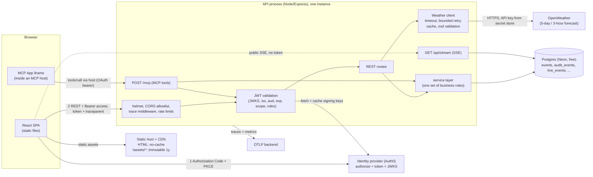
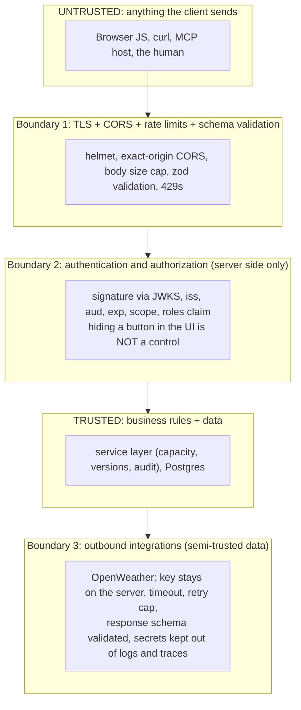

# FieldDay architecture

FieldDay is an operations board for a made-up outdoor events group. Every organization, venue, event and registration in it is synthetic. The only outside services are OpenWeather (forecast data, nothing sensitive) and the identity provider, which only ever sees who is signing in.

## Request path

## Trust boundaries

The decisions that matter most:

- **The browser is never trusted.** The page decodes the token only to decide which buttons to draw. Every write is checked again on the server for the scope (`events.write`) and the role (`coordinator`).
- **The access token is the credential.** The page uses the ID token only to check the `nonce`. The API never accepts an ID token.
- **The weather provider is a data source, not an authority.** Its response is validated against a schema, and it can't change an event. Weather flags are advice and never cancel anything on their own.
- **MCP is a second front door to the same rules.** `mcp.ts` calls the same functions in `service.ts` as the REST routes. Each tool checks its own scope, and writes also need the role.

## Data model

| Table | What it is for | Notes |
|---|---|---|
| `venues` | where events happen (lat/lon feed the weather call) | seeded, synthetic |
| `events` | the board: `capacity`, `registered`, `status`, `version` | `CHECK (registered <= capacity)`; index on `(status, starts_at)` serves the public list |
| `synthetic_registrations` | seats booked (fake labels only) | foreign key to events |
| `event_status_history` | the status trail on the detail page | foreign key to events |
| `weather_snapshots` | last good forecast per event | |
| `audit_events` | append-only before/after JSON, actor from the validated token, channel (`rest`, `mcp`, `seed`) | a trigger blocks UPDATE, DELETE and TRUNCATE |
| `live_events` | persisted live-update log with increasing ids | makes SSE replay possible |
| `mcp_confirmations` | single-use confirmation tokens, stored as SHA-256 hashes | bound to actor, event, new status, reason and version |
| `schema_migrations` | versioned migrations, each with `up` and `down` | the reversible migration is tested |

## How the tricky parts work

**Capacity under concurrency.** One conditional statement is the guard: `UPDATE events SET registered = registered + $1 WHERE id = $2 AND registered + $1 <= capacity RETURNING id`. It runs inside a transaction that first takes the row lock (`SELECT ... FOR UPDATE`). A second request waits for the row, then re-checks the condition against the committed value, so two requests can't both take the last places. If no row comes back, the API returns 409 `capacity_exceeded`. The Game Day script sends 30 simultaneous 2-seat requests at 9 free places on real Postgres: exactly 4 win and 26 get 409. The `CHECK` constraint is a second line of defense. Hand-predicted example used in the tests: capacity 40 with 31 taken leaves 9, and asking for 10 more fails and leaves the count at 31.

**Lost updates.** Edits send `expected_version`. A stale one gets 409 `version_conflict`.

**Live updates.** The service writes to `live_events` inside the same transaction as the data change, then announces it. Ids are handed out under a transaction-level advisory lock so they commit in the order they were assigned. Without that, one writer could commit id 8 before another committed id 7, and a client that had seen 8 would never get 7. On reconnect the browser's `EventSource` sends `Last-Event-ID`, the server replays only newer events, and the client drops anything it has already seen. A client that is ahead of the server (after a database reset) or too far behind is told to `resync` and reloads a snapshot. I chose SSE because updates only flow from the server to viewers, it works over ordinary HTTP and proxies, reconnect and replay are part of the protocol, and writes already go through REST.

**Weather outage policy.** Forecasts are cached by location (rounded to about 1 km) for 30 minutes, and one provider response covers every 3-hour slot in the window. If the provider fails, the API serves the last good forecast labeled `stale` with its timestamp, or `unavailable`. Events more than 5 days away return `out_of_range`, and the page says no forecast exists. Nothing is invented. The board never depends on the provider.

**Confirmed MCP write.** `propose_status_change` changes nothing and returns a token tied to the actor, event, new status, reason and event version. `change_event_status` uses it once. A different status, event, user, an expired token or a changed event version is refused.

## Known limits

- **One API instance per environment.** The rate limiter, the weather cache and the SSE wake-up bus live in the process's memory. The live-event log itself is in Postgres. Running more than one instance would need a shared store for limits and cache, plus pub/sub (Postgres LISTEN/NOTIFY or Redis) to wake streams on other instances. `scripts/cost-model.mjs` models where one instance stops being enough.
- **Free hosting sleeps.** The API sleeps after 15 idle minutes and Neon suspends after 5, so the first request after a quiet period is slow and in-memory state resets. See "Free-tier rules" in `DEPLOYMENT.md`.
- **Two database drivers.** Production uses `pg`. Tests and quick local runs can use in-process PGlite, which is real Postgres but handles one connection at a time. So the concurrency evidence (`npm run gameday` and CI) runs against a real Postgres server. Running the suite on real Postgres caught a bug PGlite couldn't: two first-time migrations racing on `CREATE TABLE IF NOT EXISTS`. It's fixed with an advisory lock.
- **`weather_snapshots` is never pruned.** At the default settings that's about 0.1 GB a year.
- **No refresh tokens in the browser.** The access token lives in memory only, so reloading the page signs you out. Public pages don't need a login.
- **Signing out only clears the page's token.** The identity provider keeps its own session cookie, so clicking Sign in right after Sign out logs you straight back in. A fresh private window avoids that.
- **The MCP App has only been tested with a fake host so far** (see `REQUIREMENTS.md` for the current status).
